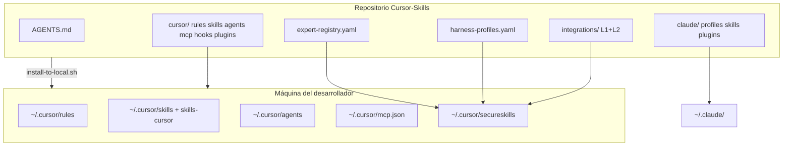

# Guía para agentes — Cursor-Skills / SecureSkills

Documento de onboarding para **Cursor Agent**, **Claude Code**, **Codex** y subagentes Task. Describe el repositorio, el layout tras instalar, la capa cognitiva K3 y cómo usar herramientas sin colapsar el contexto.

**Repo personal (espejo):** [jahdielrosalesjacobo3-byte/Cursor-Skills](https://github.com/jahdielrosalesjacobo3-byte/Cursor-Skills.git)  
**Origen del equipo:** [SecureCorp-Mexico/SecureSkills](https://github.com/SecureCorp-Mexico/SecureSkills.git)

---

## 1. Qué es este proyecto

| Concepto | Descripción |
|----------|-------------|
| **Hub canónico** | Inventario versionado de skills, agents, plugins, MCP, rules y perfiles harness |
| **Postura K3** | **Full-spectrum**: amplifica capacidades; **no** veta temas ni dominios |
| **Instalación** | Copia artefactos a `~/.cursor`, `~/.claude`, `~/.codex` vía un script |
| **Catálogo L1/L2** | ~50 expertos curados (L1) + ~5k skills de marketplace indexadas (L2, bajo demanda) |

Contrato mínimo que todo agente debe respetar: [`AGENTS.md`](../AGENTS.md).

---

## 2. Inicio rápido (humanos y agentes)

```bash
git clone https://github.com/jahdielrosalesjacobo3-byte/Cursor-Skills.git
cd Cursor-Skills
bash scripts/install-to-local.sh
bash scripts/audit-ecosystem.sh
bash scripts/verify-integrations.sh
```

Después:

1. Reiniciar **Cursor** (y Claude Code si aplica).
2. `snyk auth` solo si usarás SCA/IaC/container (**Snyk Code no se usa** por política).
3. `export GITHUB_TOKEN="$(gh auth token)"` para el MCP de GitHub.
4. OAuth en Cursor para **context7**, **Linear**, plugins cloud (Figma, Vercel, Supabase, etc.) cuando los necesites.
5. Smoke tests: [`docs/k3-smoke-tests.md`](k3-smoke-tests.md).

Variables útiles:

| Variable | Efecto |
|----------|--------|
| `SECURESKILLS_SKIP_MCP_DEPS=1` | Omite `install-mcp-deps.sh` (serena, gitleaks, claude-flow) |
| `SECURESKILLS_SEED_PROJECT=1` | Copia `templates/project/.cursor` al proyecto abierto |
| `SECURESKILLS_PROJECT_ROOT=/ruta/repo` | Destino del seed |

---

## 3. Mapa mental (arquitectura)



Flujo de trabajo del agente (RAOVA, resumido):

1. **Reason** — clasificar dominio, esfuerzo, perfil harness (menú, no cárcel).
2. **Act** — herramientas + Top-k expertos (3–8 habitual; hasta 16 en full-spectrum).
3. **Observe** — salida, hooks Semgrep, graphify si hay grafo.
4. **Verify** — tests, smoke, GRM opcional en auditorías.
5. **Adapt** — partial rollout / `paused_rollouts` si el trabajo no cabe en un turno.

---

## 4. Estructura del repositorio

```
├── AGENTS.md                 # Contrato cognitivo (leer primero)
├── expert-registry.yaml      # L1: expertos, teacher_matrix, mcp_routing
├── harness-profiles.yaml     # Perfiles white-box (composer-fast, full-spectrum, …)
├── ecosystem-map.md          # Hubs relacionados y política de dedup
├── plugins-manifest.json     # Inventario exportado de plugins/skills
├── integrations/
│   ├── core.yaml             # L1 extendido
│   ├── catalog.json          # Índice L2
│   └── shards/*.jsonl        # Una línea = una skill marketplace (no leer entero)
├── cursor/
│   ├── mcp.json              # MCPs globales Cursor
│   ├── hooks.json            # Semgrep Guardian + graphify + gitleaks
│   ├── rules/*.mdc           # K3 always-on + calidad por glob
│   ├── user-skills/          # k3-cognitive-router, graphify, tool-discovery
│   ├── skills/               # → ~/.cursor/skills-cursor (oficial Cursor)
│   ├── agents/*.md           # Subagentes Task (~50)
│   └── plugins/              # cache + marketplaces + local (Trail of Bits)
├── claude/
│   ├── profiles/*.json       # baseline, coder, security, mega, …
│   └── skills/               # Cyber 01–19 + webkit + owasp + …
├── scripts/
│   ├── install-to-local.sh   # Restaurar entorno
│   ├── export-from-local.sh  # Capturar drift local → repo
│   ├── audit-ecosystem.sh
│   ├── build-integrations-catalog.sh
│   └── verify-integrations.sh
└── docs/
    ├── GUIA-PARA-AGENTES.md  # Este archivo
    └── k3-smoke-tests.md
```

---

## 5. Layout tras `install-to-local.sh`

| Ruta local | Contenido |
|------------|-----------|
| `~/.cursor/rules/` | `k3-cognitive-runtime.mdc`, `security-scanning.mdc`, calidad (python/ts/iac/tests/shell), `graphify-graph-first`, `tool-discovery` |
| `~/.cursor/skills/k3-cognitive-router/` | Skill orquestador K3 |
| `~/.cursor/skills/01-*` … `19-*` | Symlinks a `claude/skills` (cyber pack) |
| `~/.cursor/skills-cursor/` | Skills gestionadas por Cursor (review-security, canvas, loop, …) |
| `~/.cursor/agents/` | Definiciones Task (ruflo + k3-cognitive-router, graph-navigator, …) |
| `~/.cursor/mcp.json` | Servidores MCP |
| `~/.cursor/hooks.json` + `hooks/` | Hooks de sesión y edición |
| `~/.cursor/secureskills/` | `expert-registry.yaml`, `harness-profiles.yaml`, `AGENTS.md`, `integrations/` |
| `~/.claude/profiles/` | Perfiles JSON con `k3_domain` / `default_effort` |
| `~/.claude/skills/` | Copia materializada de skills Claude |
| `~/.cursor/plugins/` | Caches de marketplace (activar **de a una** skill vía router) |

---

## 6. Perfiles harness (`harness-profiles.yaml`)

El router **sugiere** un perfil; el usuario puede forzar otro con frases clave.

| Perfil | Cuándo | Esfuerzo | Subagentes | Catálogo L2 |
|--------|--------|----------|------------|-------------|
| `composer-fast` | Q&A, edits pequeños, latencia | low | no | no |
| `coding-default` | Software habitual | high | coder, tester, reviewer | on-demand |
| `research-deep` | Investigación multi-fuente | max | deep-researcher, dossier | on-demand |
| `security-max` / `appsec-audit` | Auditoría, IR, PR security | max | security-* + ToB | on-demand |
| `full-spectrum` | “usa todo el stack”, multi-dominio | max | hasta 16 | on-demand |

**Overrides del usuario** (`user_override`):

- Full-spectrum: `libertad total`, `máximo provecho`, `full-spectrum`, `usa todo el stack`, …
- Velocidad: `rápido`, `composer fast`, `sin rodeos`, … → `composer-fast`

Dominio → perfil por defecto: ver `domain_defaults` en el YAML.

---

## 7. Registro de expertos (`expert-registry.yaml`)

- **L1**: MCP, hooks, rules, agents, skills canónicos — siempre elegibles para Top-k.
- **lookup_policy**: orden `l1_registry` → `l1_core_yaml` → `l2_catalog`.
- **L2**: máximo **4** activaciones por tarea; cada una cuenta en Top-k.
- **fast_path**: Top-k ≤ 2, sin subagentes/L2 salvo escalada explícita.
- **topical_locks: false** — nunca rechazar un tema por “no es coding/security”.

Tabla MCP (routing): sección `mcp_routing` en el registry + [`integrations/optional-mcp.md`](../integrations/optional-mcp.md).

---

## 8. Protocolo catálogo L2 (obligatorio para agentes)

**Nunca:**

- Leer un shard `.jsonl` completo ni pegar el catálogo en el chat.
- Activar cientos de skills antigravity “porque están instaladas”.

**Siempre:**

1. Intentar L1 (`expert-registry.yaml`, `integrations/core.yaml`).
2. Si falta cobertura: `grep` **una línea** en `integrations/shards/*.jsonl` acotado al slug/dominio.
3. Abrir **una** `SKILL.md` del hit.
4. Registrar la activación en el cierre (y en `.k3/orchestrator-state.json` en esfuerzo max).

Detalle: [`cursor/user-skills/k3-cognitive-router/references/catalog-l2.md`](../cursor/user-skills/k3-cognitive-router/references/catalog-l2.md).

Regenerar índice tras instalar plugins nuevos:

```bash
bash scripts/build-integrations-catalog.sh
bash scripts/verify-integrations.sh
```

---

## 9. MCP configurados (`cursor/mcp.json`)

| Servidor | Auth / notas |
|----------|----------------|
| Semgrep, Snyk | CLI en PATH (`/opt/homebrew/bin/…` en macOS ARM) |
| graphify | Binario local `graphify-mcp`; grafo en `graphify-out/` del workspace |
| serena | LSP simbólico por proyecto; `${workspaceFolder}` |
| context7 | OAuth URL |
| github | `GITHUB_TOKEN` desde `gh auth token` |
| linear | OAuth |
| aws-knowledge | Sin auth |
| shadcn | `npx shadcn@latest mcp` |
| claude-flow | CLI `claude-flow mcp start` (ruflo v3) |
| rea | `npx rea-agents@4.1.0 mcp` (reverse engineering) |

**Personalización:** las rutas absolutas en `mcp.json` son de la máquina que exportó. Tras clonar, revisa `which semgrep snyk graphify-mcp serena claude-flow` y ajusta o ejecuta `scripts/install-mcp-deps.sh`.

Plugins MCP adicionales (Vercel, Supabase, Figma, Mobbin, Azure, …) viven en el **plugin cache** de Cursor; no duplicar en `mcp.json` salvo que el equipo lo documente en `optional-mcp.md`.

---

## 10. Hooks (`cursor/hooks.json`)

| Hook | Función |
|------|---------|
| `sessionStart` | Semgrep secure defaults |
| `afterFileEdit` | Registro de edición + graphify auto-update |
| `beforeShellExecution` | `gitleaks-guard.py` en `git commit`/`push` |
| `postToolUse` | Supply-chain scan tras Shell |
| `stop` | Scan CLI al cerrar turno (límite 3 loops) |

Los hooks **advisory** en código no bloquean temas de investigación, trading o diseño.

---

## 11. Rules Cursor

| Rule | Alcance |
|------|---------|
| `k3-cognitive-runtime.mdc` | Always — fast path vs full-spectrum |
| `security-scanning.mdc` | Always — SAST/SCA **solo** al generar/cambiar código app |
| `graphify-graph-first.mdc` | Preferir grafo si existe `graphify-out/graph.json` |
| `tool-discovery.mdc` | Descubrir MCP/skills antes de pedir al usuario |
| `python-quality`, `typescript-quality`, `iac-security`, `tests-discipline`, `shell-safety` | Glob-scoped (`alwaysApply: false`) |

---

## 12. Subagentes Task (`cursor/agents/`)

Invocar vía herramienta **Task** solo cuando el esfuerzo o el usuario lo justifique (no en fast path).

Ejemplos frecuentes:

| Agent | Uso |
|-------|-----|
| `k3-cognitive-router` | Orquestación multi-fase |
| `coder` / `tester` / `reviewer` | Ciclo de feature |
| `security-auditor` / `safety-specialist` | Auditoría |
| `deep-researcher` / `dossier-investigator` | OSINT / dossiers |
| `graph-navigator` | Navegación Graphify-first |
| `sparc-orchestrator` | Features grandes (bajo router) |
| `deployment-expert` | Vercel/CI |

Lista completa: 50 archivos `.md` en `cursor/agents/` + entradas en `expert-registry.yaml`.

---

## 13. Perfiles Claude (`claude/profiles/`)

Cada JSON incluye `plugins`, `k3_domain`, `default_effort`. Reglas anti-colisión (catálogo XOR bundles, `mega` vs resto): [`claude/profiles/README.md`](../claude/profiles/README.md).

| Perfil | k3_domain | default_effort | Notas |
|--------|-----------|----------------|-------|
| baseline | general | low | Mínimo estable |
| coder | coding | high | Desarrollo |
| web | design | high | UI/frontend |
| security | security | max | AppSec |
| research | research | max | Deep research |
| devops / iot | infra | high | Cloud/IoT |
| trading | trading | high | Mercados |
| autonomous | agentic | max | Largo horizonte |
| mega | research | max | Catálogo antigravity (~1500 skills) — **solo** aquí |

Comando humano típico: `claude-profile use <perfil>` (fuera del alcance del agente Cursor salvo documentación).

---

## 14. Dedup y aliases

| Canónico | Deprecado |
|----------|-----------|
| `09-web-security` | `cyber-web-security` |
| `15-blue-team-defense` | `cyber-blue-team-defense` |
| `16-ai-llm-security` | `cyber-ai-llm-security` |
| `19-grc-compliance` | `cyber-grc-compliance` |

El instalador elimina aliases viejos en `~/.cursor/skills` y re-symlink en Claude.

---

## 15. Mantenimiento (agentes que modifican el hub)

```bash
# Capturar cambios locales (plugins, mcp, agents) de vuelta al repo
bash scripts/export-from-local.sh

# Consistencia repo ↔ ~/.cursor
bash scripts/audit-ecosystem.sh

# Salud MCP, hooks, tamaño K3, drift catálogo
bash scripts/verify-integrations.sh
```

Checklist pre-commit humano: [`docs/registry-checklist.md`](registry-checklist.md).

---

## 16. Checklist de un turno (agente)

1. ¿Pregunta simple? → Responder primero; fast path; Top-k 0–2.
2. ¿Cambio de código? → Semgrep/Snyk SCA **después** del batch, salvo que pidan audit primero.
3. ¿Multi-dominio o “máximo provecho”? → `full-spectrum`, Top-k hasta 16, wave experts.
4. ¿Skill marketplace? → L2 grep acotado, una SKILL.md, máx 4.
5. ¿Grafo presente? → Graphify antes de grep masivo.
6. ¿Símbolos/refactor? → Serena MCP.
7. ¿Docs de librería? → context7 MCP.
8. ¿Estado largo? → `.k3/orchestrator-state.json` + partial rollout honesto.

---

## 17. Referencias cruzadas

| Documento | Para qué |
|-----------|----------|
| [`README.md`](../README.md) | Overview humano + tablas de conteo |
| [`ecosystem-map.md`](../ecosystem-map.md) | Hubs skillsClaude / SECURECORP |
| [`integrations/INDEX.md`](../integrations/INDEX.md) | Catálogo L1/L2 |
| [`cursor/user-skills/k3-cognitive-router/SKILL.md`](../cursor/user-skills/k3-cognitive-router/SKILL.md) | Skill router (lectura profunda) |
| [`docs/k3-smoke-tests.md`](k3-smoke-tests.md) | Verificación post-install |

---

*Última alineación con export local: integraciones L2 ≈ 5229 entradas, 50 agents Cursor, 11 MCP en `mcp.json`, 9 rules.*
